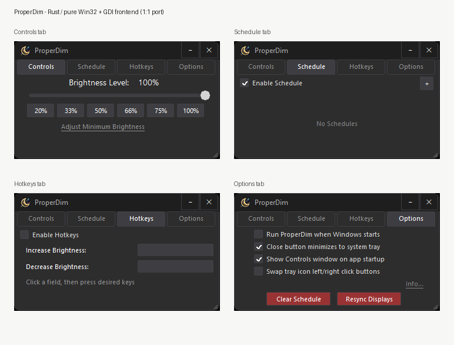

# ProperDim · Rust 移植版

把 [ProperDim](https://github.com/crustyoldhuman/ProperDim)（C# / WPF 的屏幕调光工具）用 **Rust + 纯 Win32 / GDI** 重写了一遍：
零第三方 crate、单个 exe、常驻内存约 15 MB，不需要 .NET 运行时。



## 功能

- **全局亮度调节**：硬件 gamma LUT + Magnification 两层叠加，1% – 100% 无级调节，带缓动动画
- **多显示器**：逐屏应用，识别虚拟屏 / 远程桌面 / 采集卡，读取 HDR 状态
- **定时计划**：按「时间 + 星期」触发；开机、锁屏解锁、休眠唤醒后自动补上错过的计划
- **全局热键**：点一下输入框，按什么键就是什么键，即时生效
- **托盘 + QuickDim**：托盘左键开面板、右键弹滑块，滚轮按 5% 吸附
- **最低亮度下限**：给夜间使用留一条安全底线，防止热键把屏幕按到全黑
- **配置**：`settings.json` 与 C# 版完全兼容，可直接互读（优先存 exe 同目录，不可写时用 `%LOCALAPPDATA%\ProperDim\`）

## 下载

到 [Releases](https://github.com/s13mjl/ProperDim-rust/releases) 下载 `ProperDim.exe`，双击就能用：

- 免安装，不用 .NET 运行时，单个文件约 825 KB
- 需要 Windows 10 及以上（x64）
- 卸载时复位亮度用 `ProperDim.exe --reset`（对应上游 Inno Setup 的卸载钩子）

## 使用

| 操作 | 说明 |
|---|---|
| 托盘左键 | 打开控制面板 |
| 托盘右键 | 弹 QuickDim 滑块（Options 里可切换成原生菜单 / 互换左右键） |
| 控制面板 ✕ | 最小化到托盘（Options 里可改成直接退出） |
| Ctrl + 滚轮 | 精确 1% 调亮度，否则按 5% 吸附 |
| Tab / Shift+Tab | 键盘遍历控件 |

## 从源码构建

```bash
cargo build --release --offline     # 零依赖，不需要联网
cargo test --offline                # 17 项单元测试
```

产物是 `target/release/ProperDim.exe`。另外两个调试入口：

```bash
ProperDim.exe --demo     # 只演示界面，后端打桩，不改实际亮度
ProperDim.exe --bench    # 性能实测，结果写到同目录 bench.txt
```

目标平台 `x86_64-pc-windows-msvc`。图标资源由 `build.rs` 直接生成 `.res` 交给链接器，不依赖 Windows SDK 的 `rc.exe`。

## 实现说明

| Rust 文件 | 对应上游 | 内容 |
|---|---|---|
| `src/native.rs` | `NativeMethods.cs` | 全部 Win32 常量 / 结构体 / DllImport，含结构体布局断言 |
| `src/theme.rs` | `App.xaml` + 各 ControlTemplate | 暗色主题、双缓冲 GDI、圆角窗口、自绘控件、GDI+ 抗锯齿 |
| `src/config.rs` | `ConfigManager.cs` | 26 个配置字段、手写 JSON（与 System.Text.Json 的格式一致） |
| `src/backend.rs` | `HardwareGammaService.cs` | gamma LUT、watchdog、Magnification、显示器枚举、热键解析 |
| `src/app.rs` | `App.xaml.cs` / `MainWindow.xaml.cs` | 托盘、亮度映射与动画、计划调度、会话/电源、崩溃恢复 |
| `src/ui/*` | 各 `Window` / `ControlPanel` / 对话框 | 窗口框架、四个 Tab、QuickDim、四个对话框 |
| `src/main.rs` | `App.OnStartup` | 单实例、DPI、消息循环 |

三个踩过的坑，写在这里免得后来者再踩：

1. **`SetDeviceGammaRamp` 单次阻塞约 11ms**（驱动在等垂直同步）。放在 UI 线程上会直接吃掉 16ms 的帧预算，所以 gamma 写入走专用工作线程，UI 只投递「目标值」，并且只保留最新值（合并槽）。
2. **`WM_TIMER` 会被系统合并**——队列里还有别的消息时，两拍只给一拍。拿它当动画帧时钟，帧间隔会稳定地变成 16/31ms 交替。改成由消息循环按截止时间驱动（`MsgWaitForMultipleObjectsEx` 超时 + 到期 tick）。
3. **高刷鼠标的 `WM_MOUSEMOVE` 会把 `WM_PAINT` 饿死**（后者的消息优先级更低），拖动时表现为拖影、一顿一顿。按 ~100Hz 合并拖动输入后重绘才跟得上。

## 与上游的差异

功能与交互按上游逐行对齐，包括那些容易漏掉的细节：`CloseToTray=false` 真正退出、日程列表按「下次触发时间」排序、`ValidateTime` 的星期交集判定、预览隔离与 500ms 防抖、热键录制、窗口尺寸/位置持久化、崩溃时恢复屏幕亮度等。

仍然存在的差异都属于**框架机制**层面，不影响功能：

1. **托盘右键默认是原生弹出菜单**，上游是自绘的 QuickDim 滑块窗口（Options 里可切换）
2. **WPF 的 GPU 观感机制**无法逐行对应：`DropShadowEffect`、`VisualBrush` + `OpacityMask`、分层窗口透明度动画；圆角已用 `SetWindowRgn` 等价实现
3. **滚动条为自绘近似**：缺少 `ScrollViewer` 的平滑滚动动画与像素级拖动换算
4. **窗口拖拽**：上游锁定宽高比、只允许横向拖动；本版用系统边框自由拖拽，仅用 `WM_GETMINMAXINFO` 限制在 150% 以内
5. **ComboBox** 用原生弹出菜单替代 WPF 下拉框
6. **焦点顺序**按控件创建顺序（WPF 按视觉树 + `FocusScope`）
7. 上游的死代码 / 无等价物未移植：`SetCursorPos`（从未调用）、`MonitorsChanged`（无订阅者）、MSIX `StartupTask`（WinRT）

## 许可

沿用上游的 [GPL-3.0](LICENSE)。原作者 **Kevin Stanislawski**（[crustyoldhuman](https://github.com/crustyoldhuman)），本项目是基于其 [ProperDim](https://github.com/crustyoldhuman/ProperDim) 的二次开发。

> 上游部分源文件头部另有 Apache-2.0 + Commons Clause 的声明，与仓库 LICENSE（GPL-3.0）不一致；本项目以 LICENSE 为准。
